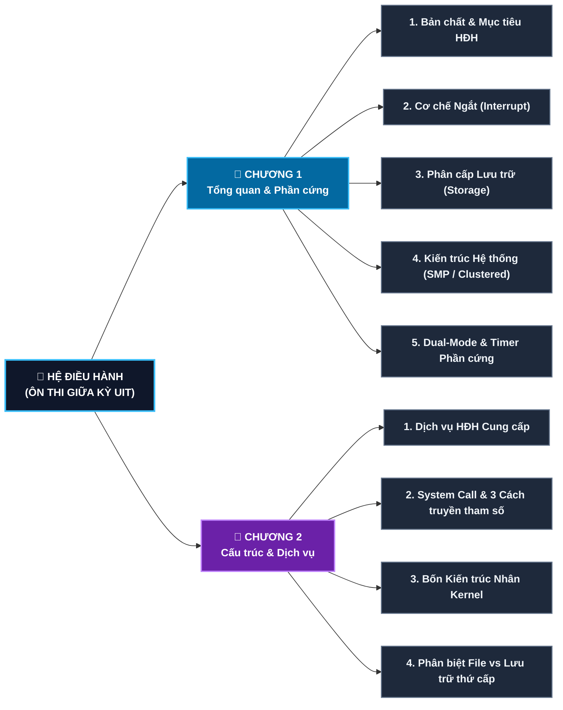
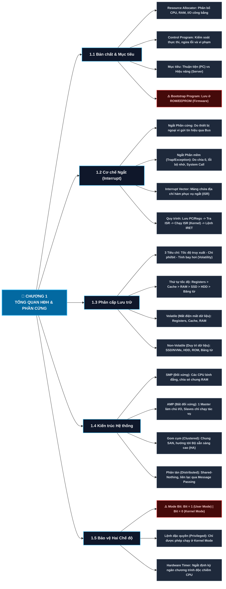
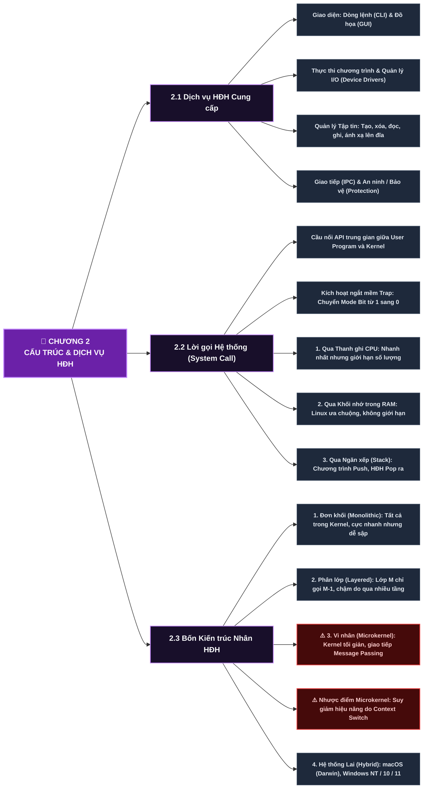
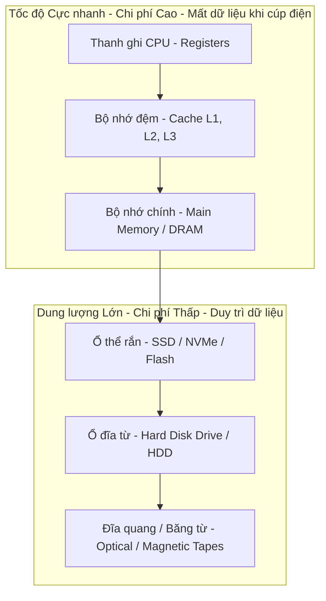
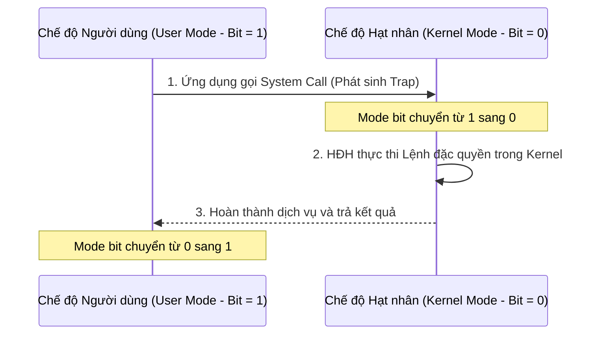
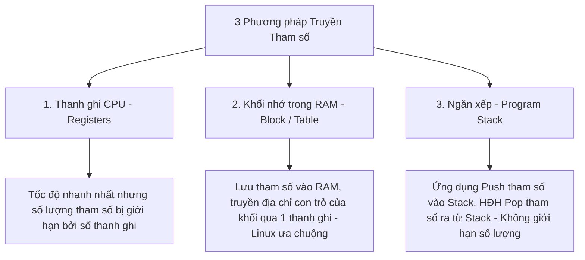
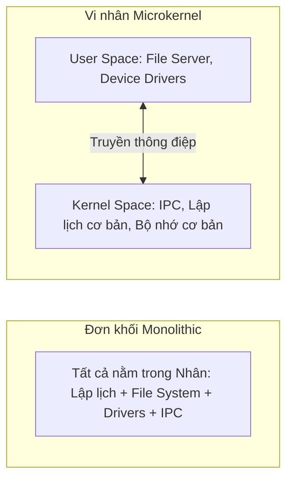

# 🧠 BẢN ĐỒ TƯ DUY (MINDMAP) HỆ ĐIỀU HÀNH — CHƯƠNG 1 & CHƯƠNG 2
> **Tài liệu ôn tập thi giữa kỳ (GK) bám sát đề thi và Slide bài giảng UIT**  
> *Định dạng chuẩn tối ưu hóa hiển thị trên GitHub (sơ đồ Mermaid phẳng hóa chống rối mắt, bảng đối chiếu trực quan, Callouts ghi nhớ).*

---

## 📑 MỤC LỤC NHANH
1. [Sơ đồ Tư duy Tổng quan (Mermaid Diagrams)](#-1-sơ-đồ-tư-duy-tổng-quan)
   - [1.1. Khung Trục Toàn cảnh (High-Level Architecture)](#11-khung-trục-toàn-cảnh)
   - [1.2. Sơ đồ Chi tiết Chương 1: Tổng quan & Phần cứng](#12-sơ-đồ-chi-tiết-chương-1)
   - [1.3. Sơ đồ Chi tiết Chương 2: Cấu trúc & Dịch vụ HĐH](#13-sơ-đồ-chi-tiết-chương-2)
2. [Chương 1: Tổng quan HĐH & Kiến trúc Máy tính](#-chương-1-tổng-quan-hđh--kiến-trúc-máy-tính)
   - [1.1. Bản chất & Mục tiêu của Hệ điều hành](#11-bản-chất--mục-tiêu-của-hệ-điều-hành)
   - [1.2. Cơ chế Ngắt (Interrupt) & Xử lý Ngắt](#12-cơ-chế-ngắt-interrupt--xử-lý-ngắt)
   - [1.3. Phân cấp Hệ thống Lưu trữ (Storage Hierarchy)](#13-phân-cấp-hệ-thống-lưu-trữ-storage-hierarchy)
   - [1.4. So sánh các Mô hình Kiến trúc Hệ thống](#14-so-sánh-các-mô-hình-kiến-trúc-hệ-thống)
   - [1.5. Cơ chế Bảo vệ Hai Chế độ (Dual-Mode Operation)](#15-cơ-chế-bảo-vệ-hai-chế-độ-dual-mode-operation)
3. [Chương 2: Cấu trúc & Dịch vụ của Hệ điều hành](#-chương-2-cấu-trúc--dịch-vụ-của-hệ-điều-hành)
   - [2.1. Các Dịch vụ Cốt lõi của HĐH](#21-các-dịch-vụ-cốt-lõi-của-hđh)
   - [2.2. Lời gọi Hệ thống (System Calls) & 3 Cách Truyền tham số](#22-lời-gọi-hệ-thống-system-calls--3-cách-truyền-tham-số)
   - [2.3. Bảng So sánh Toàn diện 4 Kiến trúc Nhân HĐH](#23-bảng-so-sánh-toàn-diện-4-kiến-trúc-nhân-hđh)
4. [Bảng Bẫy Trắc nghiệm & Từ khóa "Ăn Điểm"](#-bảng-bẫy-trắc-nghiệm--từ-khóa-ăn-điểm)

---

## 🗺️ 1. SƠ ĐỒ TƯ DUY TỔNG QUAN

### 1.1. Khung Trục Toàn cảnh
*Sơ đồ định hướng khung sườn 2 chương, giúp nắm bắt nhanh toàn bộ nội dung trọng tâm thi giữa kỳ:*

---

### 1.2. Sơ đồ Chi tiết Chương 1
*Được thiết kế theo luồng ngang (Left-to-Right) chống rối mắt; các node viền đỏ đánh dấu bẫy đề thi:*

---

### 1.3. Sơ đồ Chi tiết Chương 2
*Phân tách rành mạch Dịch vụ HĐH, Lời gọi hệ thống và 4 Kiến trúc nhân:*

---

## 📘 CHƯƠNG 1: TỔNG QUAN HĐH & KIẾN TRÚC MÁY TÍNH

### 1.1. Bản chất & Mục tiêu của Hệ điều hành
| Tiêu chí | Nội dung chi tiết | Ghi chú thi trắc nghiệm |
| :--- | :--- | :--- |
| **Định nghĩa** | Chương trình đóng vai trò trung gian giữa phần cứng máy tính và người sử dụng. | *HĐH không trực tiếp giải quyết bài toán của người dùng (ứng dụng mới làm việc đó).* |
| **Hai vai trò cốt lõi** | 1. **Resource Allocator:** Quản lý và phân phối công bằng tài nguyên (CPU, RAM, I/O). 2. **Control Program:** Kiểm soát việc thực thi chương trình để tránh lỗi và ngăn chặn hành vi sử dụng trái phép. | *Từ khóa:* Quản lý tài nguyên & Kiểm soát thực thi. |
| **Mục tiêu chính** | 1. **Thuận tiện (Convenience):** Giúp người dùng tương tác dễ dàng. 2. **Hiệu quả (Efficiency):** Khai thác tối đa hiệu năng phần cứng. | Máy tính cá nhân (PC) ưu tiên thuận tiện; Máy chủ (Server) ưu tiên hiệu quả. |
| **Bootstrap Program** | Chương trình khởi động đầu tiên khi bật nguồn hoặc khởi động lại. • Lưu trữ tại: **ROM hoặc EEPROM** (Firmware). • Nhiệm vụ: Kiểm tra phần cứng $\to$ Nạp nhân (Kernel) của HĐH vào RAM $\to$ Chạy tiến trình đầu tiên (`init` / `systemd`). | *Bẫy trắc nghiệm:* Bootstrap KHÔNG nằm trên RAM hay ổ đĩa cứng thông thường. |

---

### 1.2. Cơ chế Ngắt (Interrupt) & Xử lý Ngắt

| Loại ngắt | Nguồn gốc phát sinh | Ví dụ cụ thể |
| :--- | :--- | :--- |
| **Ngắt phần cứng (Hardware Interrupt)** | Thiết bị ngoại vi gửi tín hiệu điện áp qua bus hệ thống tới CPU. | Bàn phím được nhấn, chuột di chuyển, ổ đĩa đọc xong dữ liệu, Timer hết giờ. |
| **Ngắt phần mềm (Trap / Exception)** | Do lỗi phần mềm phát sinh khi thực thi lệnh hoặc do người dùng chủ động yêu cầu dịch vụ. | Chia cho số 0, truy xuất địa chỉ bộ nhớ bất hợp pháp, thực thi **System Call**. |

> [!IMPORTANT]
> **Véc-tơ ngắt (Interrupt Vector):** Là một mảng con trỏ nằm ở vùng nhớ thấp cố định, chứa địa chỉ bộ nhớ của các chương trình phục vụ ngắt tương ứng (**Interrupt Service Routine - ISR**).

---

### 1.3. Phân cấp Hệ thống Lưu trữ (Storage Hierarchy)
Hệ thống lưu trữ được phân cấp dựa trên **3 tiêu chí cốt lõi**:
1. **Tốc độ truy xuất (Speed)**
2. **Chi phí trên mỗi bit lưu trữ (Cost per bit)**
3. **Tính bay hơi / Khả năng duy trì dữ liệu khi mất điện (Volatility)**

| Tầng lưu trữ | Công nghệ chế tạo | Thời gian truy xuất | Tính bay hơi | Quản lý bởi |
| :--- | :--- | :---: | :---: | :--- |
| **Registers** | Phần cứng bên trong CPU | $< 1$ ns | **Bay hơi (Volatile)** | Trình biên dịch (Compiler) |
| **Cache (L1, L2, L3)** | SRAM bán dẫn tốc độ cao | $1 - 10$ ns | **Bay hơi (Volatile)** | Phần cứng CPU tự động |
| **Main Memory (RAM)** | DRAM bán dẫn | $50 - 100$ ns | **Bay hơi (Volatile)** | Hệ điều hành |
| **SSD / NVMe** | Flash Memory (NAND) | $10 - 100 \ \mu\text{s}$ | **Bền vững (Non-volatile)** | Hệ điều hành |
| **Hard Disk (HDD)** | Đĩa từ quay cơ học | $5 - 10$ ms | **Bền vững (Non-volatile)** | Hệ điều hành |

---

### 1.4. So sánh các Mô hình Kiến trúc Hệ thống

#### A. Đa xử lý đối xứng (SMP) vs Đa xử lý bất đối xứng (AMP)
| Đặc điểm | Đa xử lý đối xứng (SMP) | Đa xử lý bất đối xứng (AMP) |
| :--- | :--- | :--- |
| **Mối quan hệ giữa các CPU** | **Bình đẳng (Peers):** Không có CPU nào làm chủ. | **Chủ - Tớ (Master - Slave):** 1 CPU làm Master. |
| **Phân chia công việc** | Mỗi CPU tự chạy bản sao của HĐH và tự điều phối công việc cho mình. | CPU Master điều khiển toàn bộ hệ thống, phân việc và xử lý I/O; các Slave chỉ chạy mã người dùng. |
| **Không gian bộ nhớ** | Chia sẻ chung một không gian RAM vật lý duy nhất. | Có thể chia sẻ hoặc tách biệt tùy cấu hình. |
| **Độ phổ biến** | Chuẩn kiến trúc trên hầu hết PC, Laptop và Server hiện đại. | Dùng trong các hệ thống chuyên dụng, xử lý nhúng đặc thù. |

#### B. Hệ thống Gom cụm (Clustered) vs Hệ thống Phân tán (Distributed)
| Tiêu chí | Hệ thống Gom Cụm (Clustered Systems) | Hệ thống Phân Tán (Distributed Systems) |
| :--- | :--- | :--- |
| **Khoảng cách vật lý** | Đặt gần nhau trong cùng trung tâm dữ liệu, nối qua mạng nội bộ tốc độ cao (**LAN / SAN**). | Nằm rải rác ở nhiều vị trí địa lý khác nhau, kết nối qua mạng diện rộng (**WAN / Internet**). |
| **Bộ nhớ & Ổ đĩa** | **Chia sẻ chung** thiết bị lưu trữ thông qua mạng lưu trữ **SAN (Storage Area Network)**. | **Không chia sẻ** bộ nhớ hay ổ đĩa (**Shared-Nothing**); mỗi nút có tài nguyên độc lập. |
| **Cơ chế liên lạc** | Giao tiếp nội bộ tốc độ cực cao, có cơ chế Heartbeat giám sát nhau. | Giao tiếp thuần túy qua giao thức mạng (**Message Passing / RPC / Sockets**). |
| **Mục tiêu cốt lõi** | **Độ sẵn sàng cao (High Availability - HA)**, khả năng chịu lỗi (Fault-Tolerance). | **Chia sẻ tài nguyên**, tính toán song song quy mô toàn cầu. |

---

### 1.5. Cơ chế Bảo vệ Hai Chế độ (Dual-Mode Operation)

* **Ý nghĩa của Mode Bit:**
  * `Mode Bit = 1`: **User Mode** — Dành cho các tiến trình ứng dụng thông thường. Bị giới hạn truy cập phần cứng.
  * `Mode Bit = 0`: **Kernel Mode** (Chế độ đặc quyền / Supervisor / System mode) — Dành cho nhân HĐH. Có toàn quyền truy cập toàn bộ tập lệnh và phần cứng.
* **Lệnh đặc quyền (Privileged Instructions):**
  * Là các câu lệnh có khả năng gây ảnh hưởng đến sự an toàn của toàn hệ thống nếu dùng sai.
  * **Chỉ được phép thực thi ở Kernel Mode**. Nếu ứng dụng ở User mode cố tình chạy $\to$ Phần cứng ngắt và ném Exception (Trap) xử lý lỗi ngay lập tức.
  * *Các lệnh đặc quyền điển hình:* Lệnh thay đổi giá trị Mode bit, Lệnh bật/tắt ngắt CPU, Lệnh thao tác trực tiếp thanh ghi điều khiển thiết bị I/O, Lệnh thiết lập bộ đếm thời gian (Timer).
* **Bộ đếm thời gian (Timer):**
  * Phần cứng đếm lùi thời gian. Khi về 0 $\to$ Phát tín hiệu ngắt (**Timer Interrupt**).
  * *Tác dụng:* **Ngăn chặn chương trình người dùng độc chiếm CPU** hoặc chạy vòng lặp vô tận, đảm bảo tính đa nhiệm (Time-sharing).

---

## 📗 CHƯƠNG 2: CẤU TRÚC & DỊCH VỤ CỦA HỆ ĐIỀU HÀNH

### 2.1. Các Dịch vụ Cốt lõi của HĐH
1. **Giao diện người dùng (User Interface):** CLI (Command Line Interface - dòng lệnh) và GUI (Graphical User Interface - giao diện đồ họa).
2. **Thực thi chương trình (Program Execution):** Nạp mã lệnh vào RAM, khởi tạo tiến trình, điều phối CPU và kết thúc an toàn.
3. **Thao tác I/O (I/O Operations):** Che giấu chi tiết phần cứng phức tạp thông qua các trình điều khiển thiết bị (**Device Drivers**).
4. **Quản lý Hệ thống Tập tin (File-system Management):** Tạo, xóa, đọc, ghi tập tin/thư mục; ánh xạ logic tập tin vào các sector vật lý của đĩa.
5. **Giao tiếp liên tiến trình (Communications):** Cho phép trao đổi dữ liệu qua **Vùng nhớ chia sẻ (Shared Memory)** hoặc **Truyền thông điệp (Message Passing)**.
6. **Bảo vệ & An ninh (Protection and Security):** Ngăn cách các tiến trình độc lập, xác thực đăng nhập người dùng và kiểm soát quyền truy cập tài nguyên.

---

### 2.2. Lời gọi Hệ thống (System Calls) & 3 Cách Truyền tham số

> [!NOTE]
> **Lời gọi hệ thống (System Call)** là giao diện lập trình trung gian (API) cung cấp cầu nối giữa chương trình người dùng và các dịch vụ bên trong nhân HĐH.

#### 3 Phương pháp Truyền tham số cho System Call:

| Phương pháp | Cơ chế thực hiện | Ưu điểm | Hạn chế |
| :--- | :--- | :--- | :--- |
| **1. Qua Thanh ghi CPU (Registers)** | Ghi trực tiếp giá trị các tham số vào các thanh ghi của CPU trước khi gọi lệnh ngắt. | **Nhanh nhất**, không cần truy xuất bộ nhớ. | Bị giới hạn bởi số lượng thanh ghi phần cứng hỗ trợ. |
| **2. Qua Khối nhớ / Bảng trong RAM (Block / Table)** | Lưu toàn bộ tham số thành một khối trong bộ nhớ chính RAM; chỉ truyền duy nhất **địa chỉ con trỏ** của khối nhớ đó qua một thanh ghi CPU. | **Truyền được số lượng tham số tùy ý**, dữ liệu phức tạp. | Tốn thêm chu kỳ đọc bộ nhớ RAM. *(Là phương pháp được Linux/UNIX ưa chuộng).* |
| **3. Qua Ngăn xếp (Stack)** | Chương trình người dùng **đẩy (push)** tham số vào vùng nhớ Stack; HĐH sẽ **lấy (pop)** tham số từ Stack ra. | Đơn giản, linh hoạt, không giới hạn độ dài tham số. | Tốc độ thao tác bộ nhớ Stack chậm hơn thanh ghi. |

---

### 2.3. Bảng So sánh Toàn diện 4 Kiến trúc Nhân HĐH

| Tiêu chí | 1. Kiến trúc Đơn khối (Monolithic) | 2. Kiến trúc Phân lớp (Layered) | 3. Kiến trúc Vi nhân (Microkernel) | 4. Kiến trúc Lai (Hybrid Systems) |
| :--- | :--- | :--- | :--- | :--- |
| **Bản chất thiết kế** | Toàn bộ chức năng và dịch vụ HĐH gom chung vào một file nhị phân duy nhất trong **Kernel Space**. | Chia HĐH thành $N$ tầng xếp chồng: Lớp 0 là Phần cứng, Lớp $N$ là Giao diện người dùng. | **Tối giản Kernel Space**; đẩy hầu hết dịch vụ (File system, Drivers) ra ngoài **User Space**. | Kết hợp hiệu năng của Monolithic với tính mô-đun và linh hoạt của Microkernel. |
| **Quy tắc giao tiếp** | Các hàm trong nhân gọi trực tiếp lẫn nhau qua con trỏ bộ nhớ. | **Nghiêm ngặt:** Lớp $M$ chỉ được phép gọi dịch vụ của lớp $M-1$ nằm ngay dưới nó. | Các dịch vụ người dùng giao tiếp với nhau qua cơ chế **Truyền thông điệp (Message Passing)** xuyên qua vi nhân. | Các thành phần cốt lõi chạy cùng không gian nhân, các thành phần mở rộng nạp dưới dạng modules động. |
| **Hiệu năng (Tốc độ)** | **Rất cao** (Do không tốn phụ phí chuyển ngữ cảnh giữa các vùng nhớ). | **Thấp** (Mỗi lời gọi phải xuyên qua rất nhiều lớp trung gian). | **Giảm đáng kể** (Tốn chi phí Context Switch và Copy thông điệp giữa User/Kernel mode). | **Rất tốt** (Cân bằng tối ưu giữa tốc độ và độ linh hoạt). |
| **Độ tin cậy & Bảo mật** | **Kém** (Một lỗi nhỏ trong 1 driver hay module có thể làm sập toàn bộ hệ thống - Màn hình xanh). | **Tốt** (Dễ cô lập lỗi từng lớp để kiểm thử và gỡ lỗi từ dưới lên). | **Cực kỳ cao** (Nếu một dịch vụ như File System bị lỗi thì chỉ cần khởi động lại dịch vụ đó, nhân không sập). | **Cao** (Có cơ chế cô lập và bảo vệ module). |
| **Khả năng mở rộng** | Khó sửa đổi, bảo trì khi hệ thống phình to. | Khó khăn vì rất khó phân định ranh giới chức năng các tầng. | **Rất dễ mở rộng** (Chỉ cần viết thêm tiến trình dịch vụ mới ở User space). | Dễ dàng thông qua cơ chế nạp module động (Loadable Kernel Modules - LKM). |
| **Hệ điều hành tiêu biểu** | MS-DOS, Linux truyền thống. | Hệ điều hành THE (Dijkstra). | Mach, QNX, Minix, GNU Hurd, seL4. | **macOS / iOS** (Nhân Darwin), **Windows NT / 10 / 11**. |

---

## 🎯 BẢNG BẪY TRẮC NGHIỆM & TỪ KHÓA "ĂN ĐIỂM"

> [!WARNING]
> **5 BẪY KINH ĐIỂN CẦN TRÁNH TRONG PHÒNG THI:**

| Tình huống câu hỏi trong đề thi | Đáp án đúng | Bẫy thường gặp (SAI) |
| :--- | :--- | :--- |
| **1. Chương trình Bootstrap nằm ở đâu?** | **ROM hoặc EEPROM** (Firmware). | Chọn nhầm RAM hoặc ổ đĩa cứng (HDD/SSD). |
| **2. Mode Bit bằng 0 và 1 thể hiện chế độ nào?** | **0 = Kernel Mode** (Đặc quyền) **1 = User Mode** (Người dùng). | Nhớ ngược: Tưởng 1 là cao nhất (Kernel) $\to$ **SAI**. |
| **3. Lệnh đặc quyền có được chạy ở User mode không?** | **KHÔNG BAO GIỜ**. Khi chạy sẽ bị phần cứng ngắt và ném Trap Exception. | Chọn: "Được phép nếu người dùng có quyền Administrator" $\to$ **SAI**. |
| **4. Điểm khác biệt lớn nhất giữa MQ và MFQ?** | **MQ:** Gán tiến trình cố định vào 1 hàng đợi. **MFQ:** Cho phép tiến trình di chuyển giữa các hàng đợi (hỗ trợ Aging). | Tưởng cả 2 đều cho phép di chuyển hàng đợi $\to$ **SAI**. |
| **5. Nhược điểm lớn nhất của Vi nhân (Microkernel)?** | **Hiệu năng suy giảm** do phụ phí truyền thông điệp (Message passing overhead) và chuyển ngữ cảnh liên tục. | Chọn nhầm: "Khó mở rộng" hoặc "Dễ bị sập hệ thống" $\to$ **SAI**. |

---
*Tài liệu được biên soạn đồng bộ với bộ tệp ôn tập tại thư mục `Q:\minhlele\He_dieu_hanh\`.*
